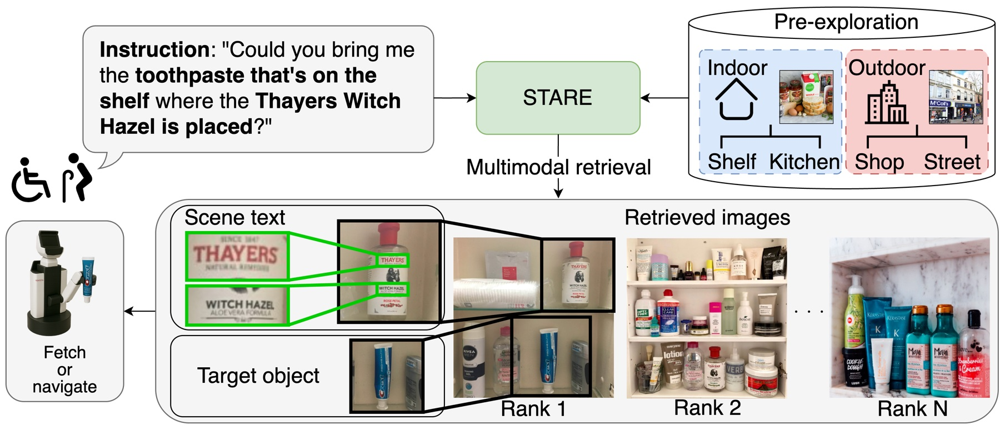
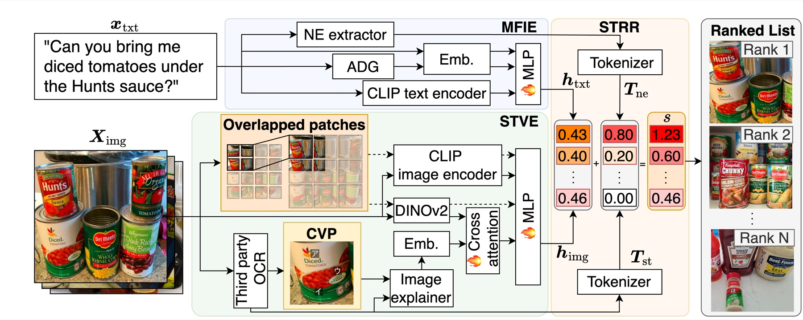

<div align="center">

# STARE: Scene Text-Aware multimodal Retrieval for Everyday objects

**ACCV 2026 Workshop on Multimodal AI for Science and the Real World (MM4SciReal)**

[Kento Tokura](https://orcid.org/0009-0009-4524-9022),
[Ryosuke Korekata](https://orcid.org/0009-0008-0354-9070),
[Daichi Yashima](https://orcid.org/0009-0005-2087-2038),
[Kei Katsumata](https://orcid.org/0009-0009-7078-457X),
[Kanon Amemiya](https://orcid.org/0009-0001-9655-7561),
[Miyu Goko](https://orcid.org/0009-0009-9233-7121),
[Komei Sugiura](https://orcid.org/0000-0002-0261-0510)

Keio University

<p>
  <a href="https://stare-projectpage.pages.dev/"></a>
  
  
</p>
<p>
  
  
  
  
</p>



</div>

## 📖 Overview

We focus on service robots that retrieve and transport everyday objects based on free-form instructions that may refer to visual features and **scene text**.
This is challenging because it requires a multimodal understanding of the visual features and spatial relationships of objects, as well as scene text embedded in the environment.

**STARE** leverages visual and textual cues in response to free-form instructions:

- 🔤 **Crosslingual Visual Prompt** enhances scene text interpretation.
- 🔗 STARE models the complex relationships between **named entities** in the instructions and their corresponding objects.
- 📊 We evaluate STARE on two novel benchmarks, **GoGetIt** and **TextCaps-test**, where it outperforms all baseline methods, and achieves an **80%** success rate in zero-shot physical experiments.

<div align="center">
  
</div>

## 🛠️ Installation

**Requirements**: CUDA 11.8 and [uv](https://docs.astral.sh/uv/).

```sh
git clone https://github.com/keio-smilab24/STARE.git
cd STARE
uv sync
```

> [!NOTE]
> This project is configured for CUDA 11.8. If you are using a different CUDA version, check the appropriate PyTorch index URL in [PyTorch Previous Versions](https://pytorch.org/get-started/previous-versions/) and update the `[[tool.uv.index]]` section in `pyproject.toml` accordingly.

## 📦 Data and Checkpoint

Download the dataset:

```sh
bash scripts/download_dataset.sh
```

Download the pretrained checkpoint:

```sh
bash scripts/download_pretrained_model.sh
```

## 🚀 Usage

### Train

```sh
bash scripts/train.sh
```

### Test

```sh
bash scripts/test.sh
```

### Inference server (optional)

The `start_server` mode extracts features from new images and instructions with third-party APIs. Set the following variables in a `.env` file before you run it:

```sh
OPENAI_API_KEY=<your OpenAI API key>
GOOGLE_APPLICATION_CREDENTIALS=<path to your Google Cloud Vision credentials JSON>
```

## 📊 Results

Mean ± standard deviation over five runs with different seed values [%].

<div align="center">

| Benchmark | Recall@5 ↑ | Recall@10 ↑ | Recall@20 ↑ |
| :-- | :--: | :--: | :--: |
| GoGetIt (RefText) | 90.2 ± 0.4 | 94.4 ± 0.4 | 96.9 ± 0.3 |
| GoGetIt (Instruction) | 89.8 ± 0.6 | 92.8 ± 0.6 | 95.6 ± 0.2 |
| TextCaps-test | 92.4 ± 1.3 | 95.4 ± 0.6 | 98.3 ± 0.4 |
| LTRRIE | 72.5 ± 0.8 | 86.6 ± 0.9 | 95.4 ± 0.9 |

</div>

## 📝 Citation

If you find this work useful, please cite:

```bibtex
@inproceedings{tokura2026stare,
  title     = {{STARE}: Scene Text-Aware multimodal Retrieval for Everyday objects},
  author    = {Kento Tokura and Ryosuke Korekata and Daichi Yashima and Kei Katsumata and Kanon Amemiya and Miyu Goko and Komei Sugiura},
  booktitle = {ACCV 2026 Workshop on Multimodal AI for Science and the Real World (MM4SciReal)},
  year      = {2026},
  note      = {Accepted, to appear}
}
```
